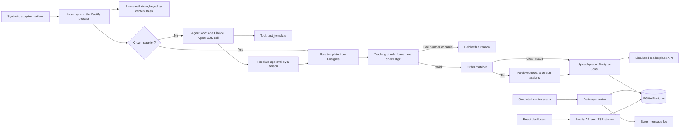

# Parcel Relay

Parcel Relay turns supplier shipping emails into checked tracking numbers on the right marketplace orders, uploads each one exactly once, and follows the parcel to delivery.


Full video: https://github.com/ArchiusVuong-sudo/parcel-relay/releases/download/v0.1/demo.mp4

## What it does

- Pulls shipping emails from a synthetic supplier mailbox and parses each known supplier with its own rule template (plain text, HTML table, or tracking inside a link).
- Checks every tracking number against its carrier's format and check digit, and holds bad numbers or carriers the marketplace does not accept before anything is queued. A resent email is caught as a duplicate.
- Matches each shipment to an open order with a visible score breakdown. Clear matches upload on their own; a repeat buyer with two open orders goes to a person.
- Uploads tracking through a Postgres job queue that survives rate limits and lost replies, so the marketplace ends up with one tracking per order. A cancelled order goes to dead letter after one try.
- For a supplier it has never seen, makes one Claude call that drafts a parser. The app tests it, a person approves it, and from then on that supplier is parsed by rule with no LLM call.
- Replays carrier scans on a simulated clock, sends one shipped and one delivered buyer message per order, and flags orders past their handling deadline with no tracking.

## Architecture



## How it works

**Parsing.** A supplier is known by its sender domain. Its template is one regex per field (tracking number, carrier, buyer, street, postal code, items), stored as JSON in Postgres. Every pattern runs through the same guard, seeded or drafted: a 200 character cap, exactly one capture group, no backreferences, no nested quantifiers, and execution in a fresh `vm` context with a 50 ms timeout, on input capped at 20 KB.

**Tracking check.** The carrier name maps to one of four invented carriers. Three use public check-digit methods (UPU S10, GS1 mod-10, Luhn); the supplier's own courier has no check digit and is not on the simulated marketplace's carrier list, so its numbers are held for the seller. The app never invents a replacement number.

**Dedupe.** `shipments.dedupe_key` (carrier plus normalized tracking number) is unique. A second email with the same tracking hits the key and is marked duplicate, so it never reaches the queue.

**Matching.** Each open order gets a score from five weighted criteria: buyer name 0.30, street 0.25 (abbreviations normalized), postal code 0.20, item words 0.15, and a date window 0.10. The matcher assigns on its own only when the top score is at least 0.85 and leads the next order by 0.10. Anything else goes to Review with the candidates side by side, and the decision lands in the order timeline (`order_events`).

**Upload queue.** Jobs live in a `jobs` table with a unique idempotency key per order and tracking number. A worker claims due jobs with `FOR UPDATE SKIP LOCKED`, and an expired lease makes a stuck job claimable again. Transient failures (429, timeout, 5xx) back off exponentially from 2 s with jitter, and `Retry-After` is honoured. Permanent errors (cancelled order, carrier refused) go straight to dead letter; transient ones after 5 attempts. The upload sends the idempotency key as a header, so a retry after a reply that timed out is replayed by the marketplace, not stored twice.

**Simulated marketplace.** It is mounted at `/sim/marketplace` and keeps its own tables, as a separate service would. In Flaky mode it follows a fixed fault schedule so every run looks the same: request 1 of every 7 gets a 429, request 2 commits and then answers too late for the client timeout.

**New supplier (the one LLM use).** An email from an unknown domain triggers one Claude Agent SDK call. The model gets no built-in tools, only one in-process tool, `test_template`, which runs the app's own guard and test on the email. It must return JSON that matches a schema (`outputFormat: json_schema`), and the app checks the result again with zod. The call runs with `tools: []`, `settingSources: []`, `strictMcpConfig`, `persistSession: false`, `permissionMode: 'dontAsk'`, a fresh temp `cwd`, `maxTurns: 6`, and a child environment built from an allowlist. Overloaded, rate-limit and 5xx errors are retried with backoff. The email is treated as untrusted data: patterns that copy values from the sample (names, numbers, streets) fail the test, and the drafted shipment cannot upload until a person approves the template. While a draft waits, more emails from that supplier wait too, with no extra call. The Suppliers page shows the model's fields and confidence, each pattern with its test result, the run's latency, cost estimate and turns, and a step trace.

**Delivery.** "Advance 1 day" moves the simulated clock. Seeded scans put each uploaded parcel in transit one day after upload and delivered after two. `buyer_messages` has a unique key on order and stage, so each order gets one shipped and one delivered message however often the monitor runs. The Overview tiles read from a `dashboard_tiles` view and update over server-sent events.

**Trade-offs.**
- PGlite (Postgres compiled to WebAssembly) keeps the demo to one process with no database to install. The queue is written for several workers on a server Postgres, but here one worker runs inside the web process, so lock contention is not exercised.
- Regex templates are cheap, fast and easy to review, but they are tied to one email layout. The model drafts them once instead of parsing every email.
- Replay mode: the drafter is one interface with a live and a replay implementation. Replay plays back a run recorded from a real live call (`fixtures/llm/`), matched by the email's content hash. The app uses replay when `DEMO_REPLAY=1` or no login is found, falls back to it when a live call fails, and says so on screen.

## Run it

Needs Node.js 22.

```bash
npm ci
npm start                    # builds the dashboard and server, serves http://127.0.0.1:4115
DEMO_REPLAY=1 npm start      # replay mode: no Claude login or API key needed
npm run record-fixture       # one live call; saves the run to fixtures/llm/
npm run smoke                # drives the whole flow over the API, no browser, exits 0
```

The live call uses the local Claude Code login, or `ANTHROPIC_API_KEY` when set. Click **Reset demo** to restore the seed.

| Variable | Default | Meaning |
| --- | --- | --- |
| `PORT` | `4115` | Port for the API and dashboard |
| `HOST` | `127.0.0.1` | Bind address |
| `DATA_DIR` | `./data` | PGlite database and raw email blobs |
| `DEMO_REPLAY` | unset | `1` replays the recorded model run |
| `LLM_MODEL` | `claude-sonnet-5-5` | Or `claude-opus-5-5`, `claude-haiku-5-5` |
| `ANTHROPIC_API_KEY` | unset | Only if there is no local Claude Code login |
| `LOG_LEVEL` | unset | `silent` turns off request logs |

## Tests

```bash
npm test                     # unit and PGlite integration tests, replay mode, no network
npm run typecheck            # strict TypeScript for server, dashboard and tests
PW_CHANNEL=chrome npm run test:e2e   # browser test of the main flow (or run `npx playwright install chromium` once)
npm run test:live            # opt-in: one real Agent SDK call (LIVE=1)
```

- Unit tests cover the three check-digit methods, the carrier check, the regex guard (including a pattern that only the vm timeout stops), each template layout, the matcher's auto, tie and no-match paths, the job queue (idempotent enqueue, backoff, `Retry-After`, dead letter, lease expiry, pause), the simulated marketplace and its client (429, timeout after commit, replay, cancelled order), the delivery monitor and late-risk flags, and the SDK call's isolation options, retry and replay fallback.
- The integration test runs the whole flow over HTTP against an in-memory PGlite: all four inbox batches, the review decision, template approval, two simulated days, and the final tile counts.
- The end-to-end test walks the same flow in the dashboard with Playwright, in replay mode, and fails on any console error.

## Notes

- All data is synthetic: the seller, buyers, streets, towns, suppliers, carriers and tracking numbers are invented, and sender addresses use `example.com` subdomains. The marketplace and carrier scans are simulated. Nothing here has run against a real marketplace.
- One tracking per order is enforced by the simulated marketplace; split shipments would need a tracking per package.
- A production version would read a real mailbox (IMAP or a forwarding webhook) into S3, run workers as separate processes on a server Postgres, and talk to marketplace and carrier APIs with their own rate limits.
- It would also watch rule templates for drift (a known supplier whose emails stop matching) and send those emails back through the draft and approval path.
